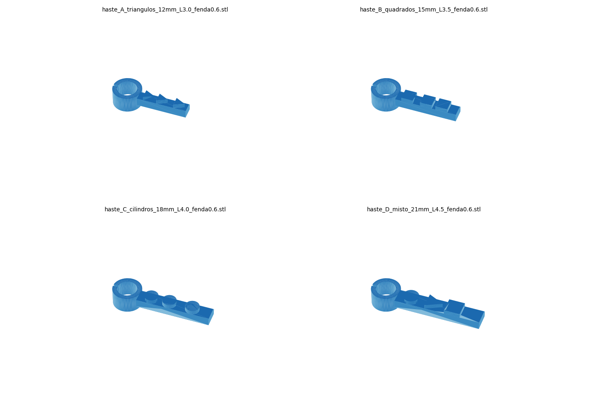

# Hastes codificadas para scanbody

[](https://doi.org/10.5281/zenodo.23069685)

Hastes impressas em 3D que se encaixam no scanbody e dão a cada implante uma forma única. Assim o scanner intraoral não se perde nas regiões lisas entre implantes, durante o escaneamento de arcada total.

É uma alternativa de baixo custo aos scanbodies horizontais comerciais e não depende do sistema de implante: o script adapta o anel a qualquer scanbody cilíndrico mudando uma medida.



> **Status:** acessório experimental, não é dispositivo médico registrado. Leia o [aviso de uso](#aviso-de-uso) antes de usar em pacientes.

## Conteúdo

| Pasta / arquivo | O que é |
| --- | --- |
| `stl/` | Modelos prontos para imprimir (hastes A–D) |
| `src/haste_scanbody.py` | Gerador paramétrico (Python 3, sem bibliotecas extras) |
| `docs/INSTRUCOES.md` | Instruções de impressão e uso clínico |
| `docs/PUBLICAR.md` | Como publicar no GitHub e gerar o DOI no Zenodo |
| `img/` | Imagens de prévia |

## As hastes

Desenvolvidas para o scanbody de minipilar cônico compatível com Neodent® Grand Morse® (Ø estimado de 4,80 mm; **meça o seu**).

| Haste | Comprimento | Largura | Símbolos no topo | Vãos entre símbolos |
| --- | --- | --- | --- | --- |
| A | 12 mm | 3,0 mm | 3 triângulos | 1,0 e 1,9 mm |
| B | 15 mm | 3,5 mm | 3 quadrados | 1,9 e 1,0 mm |
| C | 18 mm | 4,0 mm | 3 cilindros | 1,2 e 2,4 mm |
| D | 21 mm | 4,5 mm | cilindro, triângulo, quadrado | 2,2 e 1,0 mm |

Em comum a todas:
- Anel de 4 mm de altura, com fenda de 0,6 mm oposta à haste e folga radial de 0,05 mm, para encaixe por leve pressão. Encaixado na base do scanbody, afasta os tecidos moles ao redor dele e deixa o chanfro do scanbody livre e visível para o scanner.
- Haste de 2 mm de altura, com chanfro de 45° (0,5 mm) num dos lados, que quebra a simetria da seção.
- Símbolos de 1 mm de altura ocupando toda a face plana do topo.

Cada haste combina comprimento, largura, tipo de símbolo e espaçamento diferentes. Por isso nenhum trecho se repete dentro de uma haste nem entre hastes.

## Gerar para o seu scanbody

1. Meça o diâmetro externo do cilindro do scanbody (paquímetro ou micrômetro, média de 3 pontos).
2. Em `src/haste_scanbody.py`, troque `D_SCANBODY = 4.80` pela sua medida.
3. Rode:

   ```bash
   python3 src/haste_scanbody.py stl
   ```

Parâmetros úteis no topo do script:

| Parâmetro | Padrão | Efeito |
| --- | --- | --- |
| `D_SCANBODY` | 4,80 mm | Diâmetro do scanbody |
| `FOLGA` | 0,05 mm | Menor = encaixe mais justo |
| `FENDA` | 0,6 mm | `0` gera anel fechado |
| `ALTURA_ANEL` | 4,0 mm | Reduza se o anel cobrir o chanfro do scanbody |
| `CHANFRO` | 0,5 mm | Chanfro num lado da haste |
| `MARC_ALT` | 1,0 mm | Altura dos símbolos |
| `VARIANTES` | A–D | Comprimento, largura, símbolos e vãos de cada haste |

O script avisa se algum vão entre símbolos ficar abaixo de 0,8 mm.

## Uso em resumo

1. Imprima em resina (SLA, DLP ou LCD), opaca e clara. Para uso intraoral, use resina biocompatível.
2. Encaixe uma haste diferente em cada scanbody, apontando para o implante vizinho. Confira se o chanfro do scanbody ficou visível acima do anel.
3. Una as pontas das hastes com resina de baixa contração, para que nenhuma se mova.
4. Escaneie em sequência contínua passando pelas hastes.
5. Remova por cima dos scanbodies ou, com implantes divergentes, desparafusando os scanbodies e retirando tudo em bloco.

O passo a passo completo está em [docs/INSTRUCOES.md](docs/INSTRUCOES.md).

## Limitação importante

O conjunto de hastes unidas **não serve como index nem como guia de verificação**. Os anéis ficam presos por atrito, não parafusados, e as resinas contraem. Ele não transfere a posição dos implantes para um modelo físico nem comprova passividade.

## Como citar

Use o botão **"Cite this repository"** do GitHub ou o DOI do Zenodo:

> Osterne RLV. *Hastes codificadas para scanbody* [software e modelos 3D]. Versão 1.0.0. Zenodo; 2026. doi:[10.5281/zenodo.23069685](https://doi.org/10.5281/zenodo.23069685)

## Licença

- Código (`src/`): [MIT](LICENSE)
- Modelos STL, imagens e documentação: [CC BY 4.0](LICENSE-MODELS.md)

## Aviso de uso

Acessório experimental, fornecido "como está", sem garantia. Não é dispositivo médico registrado. Quem imprime e usa é responsável pela escolha da resina, pela desinfecção e por validar o encaixe e a precisão no próprio fluxo de trabalho.

Neodent® e Grand Morse® são marcas de seus respectivos titulares. Este projeto é independente e não tem vínculo com o fabricante.

---

## English summary

3D-printable, geometrically coded extensions that clip onto implant scan bodies to improve complete-arch intraoral scanning. Each extension has a unique combination of length, width, symbol shape and asymmetric spacing, so the scanning software cannot confuse neighbouring scan bodies. The extensions are splinted with resin during scanning. A dependency-free Python script regenerates the STL files for any cylindrical scan body diameter. Code: MIT. Models and documentation: CC BY 4.0. Experimental accessory, not a registered medical device. Not suitable as a verification index.
